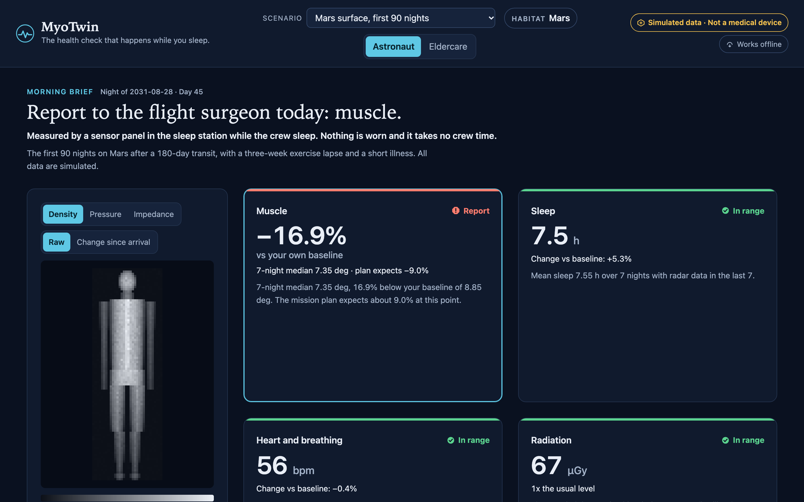
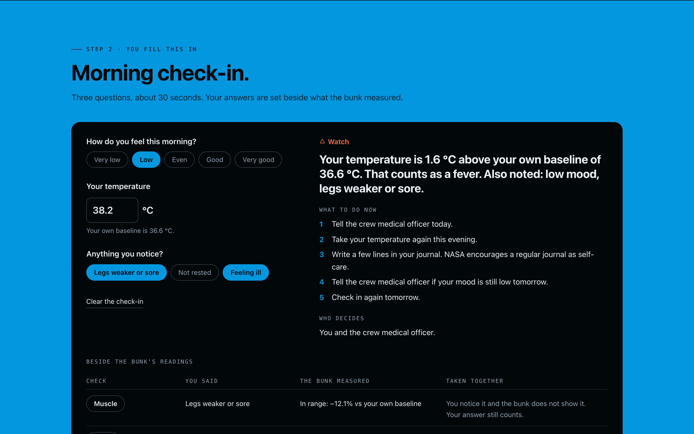
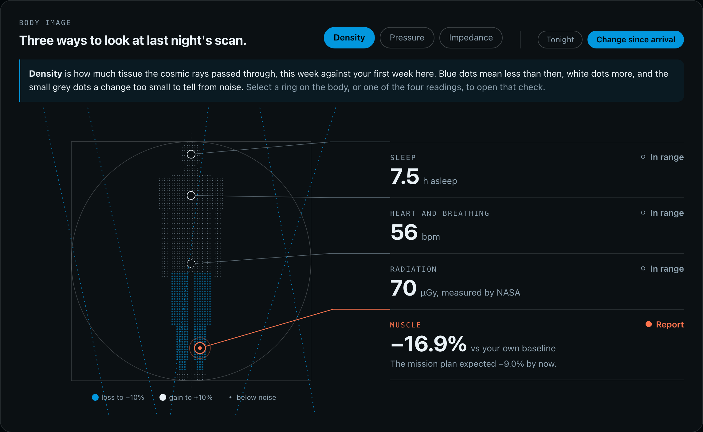

# MyoTwin

**The health check that happens while you sleep.**

MyoTwin is concept software for the 2026 NASA Space Apps Challenge
(*Create Health Monitoring Software for Astronauts on Space Missions*), team
spacesim, Kaohsiung.

On the Moon or Mars a crew member has to notice changes in their own body: a
message from Mars can take up to 20 minutes one way (V54). NASA requires crews
to keep muscle strength at or above 80% of baseline (V81). The strength tests
used on the ISS need specialized equipment in a fixed place (V82), and in 2023
NASA's evidence report said "Currently, no standard in-flight measurement of
strength exists" (V85). MyoTwin measures during the hours a crew member already
spends lying still. An assumed sensor panel in the bunk reads the calf muscle, sleep, heart
and breathing rate, and radiation overnight. In the morning the crew member
answers three questions in about 30 seconds (how they feel, their temperature,
anything they notice). One screen then shows a body figure you can click, four
checks in plain words, what the crew member said beside what the bunk measured,
what NASA says about each risk, and what to do today. A flight surgeon decides; the software only
flags. The method comes from the way clinics find muscle loss in
older adults: a tape around the calf or a short form, a strength test, then
muscle mass by DXA or bioimpedance (V94, V95). MyoTwin takes those steps to a
bunk on the Moon or Mars.

Ids such as (V85) are entries in [docs/EVIDENCE.md](docs/EVIDENCE.md).

The page is written for the crew member using it: three steps on the first
screen (check in, open a check, do today) and rows that open on click. The
sources, the limits and the method are in this file, in `docs/` and in the
slides, not on the page.

Live page: https://kaodb.github.io/myotwin/

Demo, seven slides: [PDF](https://kaodb.github.io/myotwin/demo/slides/MyoTwin-demo.pdf), or the editable [PowerPoint file](demo/slides/MyoTwin-demo.pptx).

Screenshots:







## Run it

Open `index.html` in a browser. There is no install, no server and no network
request; it also works from disk.

Run the tests with Node 22 or newer, from the repository root:

```
node --test "test/*.test.js"
```

## What is measured and what is simulated

- **Measured, replayed:** the radiation dose of every Moon and Mars night.
  Mars nights replay Curiosity's RAD from NASA's Planetary Data System, from
  94 sols of RAD data (the 90-night scenario uses sols 13 to 108) (V60).
  Moon nights replay LRO's CRaTER, including the solar particle events of
  September 2017 (V61). NASA's DONKI records mark the nights with an event
  (V62), and a chart shows NASA's OMNI proton flux (V63). The muscle model's
  partial-gravity assumption is checked, in the code and its tests, against rats at 40%
  weight bearing from NASA's Open Science Data Repository (V90, V91). The files are in
  `data/`, each with its source, units, processing and terms, and the scripts
  in `tools/data/` rebuild them from the downloads. See
  [data/README.md](data/README.md). Replaying a 2012 or 2017 night for a
  mission night is an assumption, and the Moon values were measured in lunar
  orbit, not in a habitat. In the solar-event scenario, mission night 20
  replays the night of 10 September 2017: 43.5 mGy at CRaTER's D5&6 detectors,
  about 500 times a quiet night. That pair is a lightly shielded detector on an
  orbiter (V93), not a model of a habitat. Thick habitat shielding stops most
  solar protons, so a crew inside would receive much less. Under 23 g/cm2 of
  Martian air, Curiosity's RAD saw the dose rate rise only two- to threefold in
  the same event (V92).
- **Simulated:** everything about the crew member: the muscle readings, sleep,
  heart and breathing rate, the particle directions and all three image
  layers. The simulator (`js/sim.js`) is seeded, and each scenario has its own
  simulated person, so the same scenario always gives the same nights. No real
  person's data are in this repository.
- **Entered by the person at the screen:** the morning check-in (mood,
  temperature, what they notice). The answers are kept in the page address;
  nothing is stored or sent. The temperature is judged against the person's own
  baseline, using the rise of more than 1.1 °C that counts as fever in older
  adults in long-term care (V97), because core temperature at rest shifts in
  space (V98).
- **Assumed, not built:** the sensor panel (impedance strip under the calves,
  60 GHz radar above the bunk, pressure mat, particle trackers above and below
  the sleeper). See [docs/SENSOR_ASSUMPTIONS.md](docs/SENSOR_ASSUMPTIONS.md).
- **From NASA and published sources:** the risk named on each check and its
  rating for the mission selected (NASA Human Research Roadmap, V70 to V75),
  the sentences quoted on each check (NASA risk pages, V48 to V51), the
  standards behind the lines (NASA-STD-3001 and OCHMO briefs, V76 to V84), and the published
  results the muscle model is fitted to (V4, V5).
- **Real code:** the assessment engine, the rules, the muscle model and the
  image layers, with automated tests.

The simulated nights and the mission plan come from the same model, so the
page shows the workflow, not how well a real decline would be detected.

## Where the numbers come from

Every number the code uses is either an entry in `js/evidence.js`, most with
the sentence that carries it, or a declared assumption in the module that owns
it. [docs/EVIDENCE.md](docs/EVIDENCE.md) lists both. It is generated by
`node tools/evidence-md.js > docs/EVIDENCE.md`, and a test fails if it is out
of date. Numbers taken from the data files are recomputed by tests, so the
evidence table and the data cannot drift apart.

## What this version does not account for, and the next step

1. The momentum of each cosmic-ray particle. Next: a reference block beside
   the sleeper, then a layer that measures momentum.
2. Movement during the night and tails from nuclear interactions. Next: sort
   tracks by posture with the pressure map, and run a particle-transport
   simulation.
3. Habitat shielding changes which particles arrive (V37), and thick body
   regions filter out low-momentum particles, so scattering does not scale
   linearly with thickness. One reference block calibrates one thickness only.
   Next: simulate the tracks behind the habitat and through the body.
4. Scattering measures all the material along each path. Bedding, body fluid,
   fat and muscle all add to it, and water and muscle differ by under 3% in
   radiation length (V31), so fluid loss and muscle loss look alike. Next:
   compare the signal summed over the whole limb, with the bedding fixed or
   measured, and read it beside the impedance.
5. I found no published density image of a body made this way. Next: repeat
   the ground test with sea-level muons and a body phantom (V35).
6. I found no published human impedance data from space, bed rest or the back
   of the calf (V8), and no study of bed-integrated dry electrodes (V30).
   Next: a bed-rest study beside strength tests and MRI.
7. The impedance baseline is taken on Earth, where the calf presses on the
   strip about six times harder than on the Moon (2.6 times harder than on
   Mars, V14), and fluid shifts move the reading (V28). The size of the
   arrival step is assumed. Next: measure in the last hour before waking,
   re-baseline in the first surface week, and measure the arrival step in a
   partial-gravity analogue.
8. I found no published test of radar vital signs in space (V39). Next: a mock
   sleep station and an analogue.
9. Radiation. The card shows absorbed dose (in silicon on Mars, water-corrected
   at the Moon), not effective dose, and neutrons are not measured (V46). The
   Moon nights replay a lightly shielded detector on an orbiter. Behind thick
   habitat shielding a crew would receive much less from a solar particle
   event (V92). Next: run the measured proton spectrum through a validated
   transport model of the habitat, and add a neutron channel.
10. Detection accuracy: the simulated nights and the plan share one model.
    Next: test the rules on recorded bed-rest data.
11. The transit: in weightlessness the sleeper does not rest on the panel, so
    MyoTwin starts at arrival (V42). Next: pair it with a worn sensor for the
    transit.
12. Air, noise and light are not read (V43). Next: show the habitat's
    environmental sensors beside the brief.
13. The morning check-in. One question about mood is not a tested scale, the
    temperature baseline is assumed, and the 1.1 °C step comes from care homes
    on Earth (V97). Temperature at rest has not been measured in partial
    gravity (V98). Next: learn each person's baseline from their first two
    weeks of check-ins, and try the questions in an analogue mission.

## Use of SI and earlier work

Code, tests, data files and text were produced with one SI tool, Claude (by
Anthropic) through Claude Code. The idea, the choice of what to measure and
every clinical judgement are the team member's. The form of the muscle model
comes from a private simulator written on 11-13 November 2026, before the
hackathon; everything else was written during it. Details:
[docs/SI_USE.md](docs/SI_USE.md).

## Licence

Apache License 2.0. See [LICENSE](LICENSE).

MyoTwin is not a medical device. It does not diagnose or treat.
